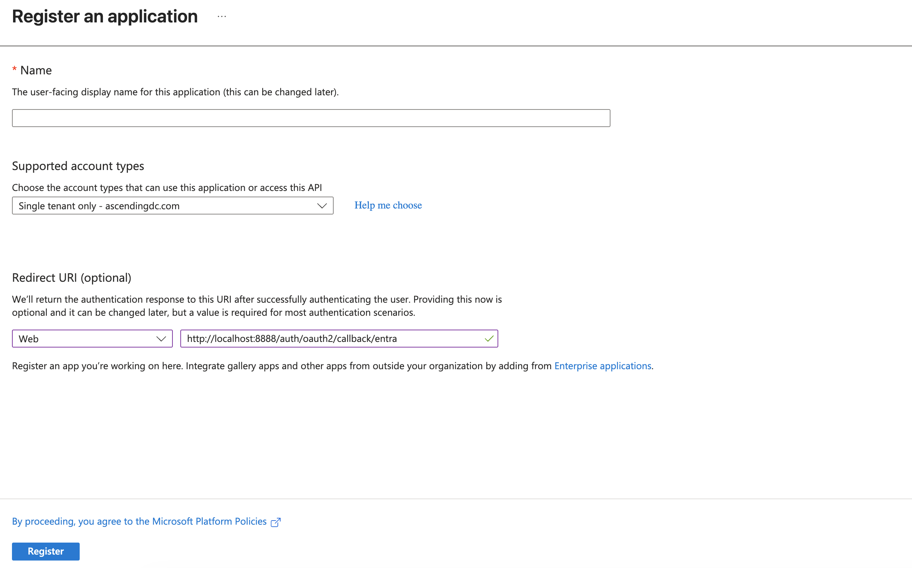
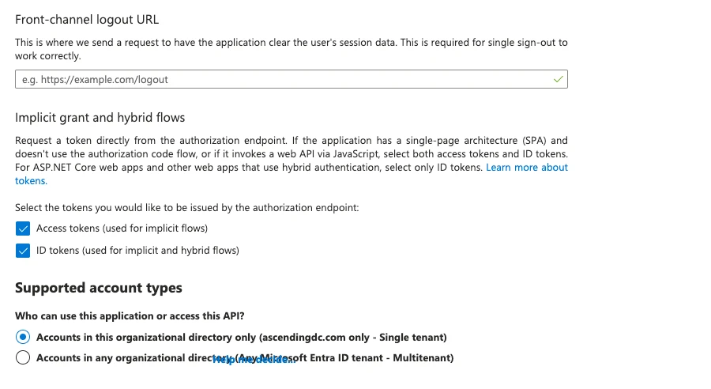

# Microsoft Entra ID (Azure AD) Setup Guide

This guide provides step-by-step instructions for setting up Microsoft Entra ID (formerly Azure AD) as an authentication provider in Jarvis Registry.

## Prerequisites

- An Azure subscription with Entra ID (Azure AD) tenant
- Access to the Azure Portal with administrative privileges
- Jarvis Registry deployed and accessible

## Step 1: Create App Registration in Azure Portal

1. **Navigate to Azure Portal**
   - Go to [Azure Portal](https://portal.azure.com)
   - In the search box, type “Azure Entra” and click on it.
   - On the left menu, click on App registrations and then on New registration.

2. **Create New Registration**
   - Click **New registration**
   - **Name**: `Jarvis Registry` (or your preferred name)
   - **Supported account types**:
     - For single tenant: *Accounts in this organizational directory only*
   - **Redirect URI**:
     - Type: **Web**
     - URI: `https://your-registry-domain/auth/oauth2/callback/entra`
     - Replace `your-registry-domain` with your actual registry URL, use `http://localhost:8888/auth/oauth2/callback/entra` for local deployment
  
   

3. **Register the Application**
   - Click **Register**
   - Note down the **Application (client) ID** and **Directory (tenant) ID**

## Step 2: Configure Authentication

1. **Configure Platform Settings**
   - In your app registration, go to **Authentication**
   - Under **Platform configurations**, ensure your redirect URI is listed
   - **Implicit grant**: Enable **ID tokens** and **Access tokens**



## Step 3: Create Client Secret

1. **Generate New Secret**
   - In your app registration, go to **Certificates & secrets**
   - Click **New client secret**
   - **Description**: `Jarvis Registry Secret`
   - **Expires**: Choose appropriate expiration (recommended: 12-24 months)
   - Click **Add**

2. **Copy the Secret Value**
   - **Important**: Copy the secret value immediately - it won't be shown again
   - Store this securely

## Step 4: Environment Configuration

Add the following environment variables to your Jarvis Registry deployment:

### Required Variables

```bash
# Microsoft Entra ID Configuration
ENTRA_CLIENT_ID=your-application-client-id
ENTRA_CLIENT_SECRET=your-client-secret-value
ENTRA_TENANT_ID=your-tenant-id
```

### Required identity claims and shared application

Chat and Registry must use the **same Entra app registration (`client_id`) within each environment**.
Entra's `sub` is pairwise per application. Both products store it in `users.openidId`, so different
client IDs would produce different subjects for the same person. Register both applications' callback
URLs on that app registration.

Before deployment, configure **Token configuration → Add optional claim → ID → `xms_edov`** on the
shared app registration. Ensure the ID token also contains the `email` claim (request the `email`
scope and configure the optional email claim as needed). Inspect claims locally without pasting or
logging the token. `xms_edov` must be the boolean `true`, not a string.

The auth server always verifies the ID token and requires `iss`, `sub` and `oid`. It reads the standard
`email` claim, never substitutes a UPN, and trusts that email for linking or provisioning only when
`xms_edov` is true. Without a trusted email, an existing stable-identity match can still sign in;
a first-time user without such a match is refused. Group membership must also grant a nonempty scope
before any user record is created.

Access tokens are used for Microsoft Graph group membership checks, not as identity tokens. A missing
or invalid ID token fails login; there is no Graph identity fallback.

See [Microsoft's optional claims reference](https://learn.microsoft.com/en-us/entra/identity-platform/optional-claims-reference)
and [identity conflict resolution](runbooks/identity-conflict-resolution.md).

### Optional display configuration

```bash
ENTRA_GRAPH_URL=https://graph.microsoft.com
ENTRA_USERNAME_CLAIM=preferred_username
ENTRA_NAME_CLAIM=name
```

The username is display information and is never used to match database users. Configure the four
scope-group Object IDs described in the [scope-group runbook](runbooks/entra-scope-groups.md); changing
display claim mappings does not change authorization group bindings.

### Deployment order

Configure the required optional claims and verify the shared client ID before deployment. Deploy the
auth-server and Registry changes together. Remove the legacy email-source and token-selection
settings from environment configuration at deployment time, not while the old code is still serving
logins. Redis login or refresh records without `user_id` are rejected with `invalid_grant` and require
a fresh login; do not clear all Redis state.

Existing OpenID users without an issuer are matched and repaired during login. The manual DEMO/PROD
cleanup scripts are not a prerequisite for customer deployments. Shared user indexes are unchanged.

## Step 5: Test the Setup

1. **Restart Services**
   - Restart the authentication server and registry services

2. **Test Authentication Flow**
   - Navigate to your registry login page
   - Select "Microsoft Entra ID" as the authentication method
   - Complete the Microsoft login process
   - Verify successful authentication and user information retrieval

## Step 6: Optional Configurations

### Group Membership Access

To retrieve user group memberships from Azure AD, ensure the following permissions are granted:

1. **In Azure Portal** → Your app registration → **API permissions**
2. Add **Microsoft Graph** → **Delegated permissions**:
   - `Group.Read.All` - Read all groups
   - Or `Directory.Read.All` - Read directory data (includes groups)
3. Click **Grant admin consent** (requires admin privileges)

**Note**: A failed group lookup produces empty scope groups. Both browser and device logins are refused when no scopes resolve, and no user is provisioned.

### Custom Scopes
Modify the `scopes` configuration in `oauth2_providers.yml` to include additional Microsoft Graph permissions as needed.

## Troubleshooting

### Common Issues

1. **Invalid Redirect URI**
   - Ensure the redirect URI in Azure matches exactly with your registry callback URL
   - Check for trailing slashes and protocol (http vs https)

2. **Insufficient Permissions**
   - Verify all required API permissions are granted with admin consent
   - Check that the user has appropriate permissions in Entra ID

3. **Token Validation Failures**
   - Verify client ID, tenant ID, and client secret are correct
   - Check token audience and issuer configuration

4. **Sovereign Cloud Issues**
   - For Azure Government or China clouds, set the appropriate `ENTRA_GRAPH_URL`
   - Ensure app registration is in the correct cloud environment
   - Verify OAuth endpoints match your cloud environment

5. **Untrusted email or identity conflict**
   - Confirm the ID token contains `email` and boolean `xms_edov: true` for first-time sign-ins.
   - Confirm Chat and Registry use the same Entra client ID.
   - Use the [identity conflict runbook](runbooks/identity-conflict-resolution.md) to diagnose refusals.
   - Do not replace stored subject or issuer fields to force an account match.

### Logs and Debugging

Enable debug logging to troubleshoot authentication issues:

```bash
# Set log level to DEBUG in your environment
AUTH_LOG_LEVEL=DEBUG
```

Check authentication server logs for detailed error messages and token validation information.

## Security Considerations

- **Client Secrets**: Rotate client secrets regularly and store them securely
- **Token Validation**: The implementation validates token signatures, expiration, and audience
- **JWKS Caching**: JWKS are cached for 1 hour to reduce API calls while maintaining security
