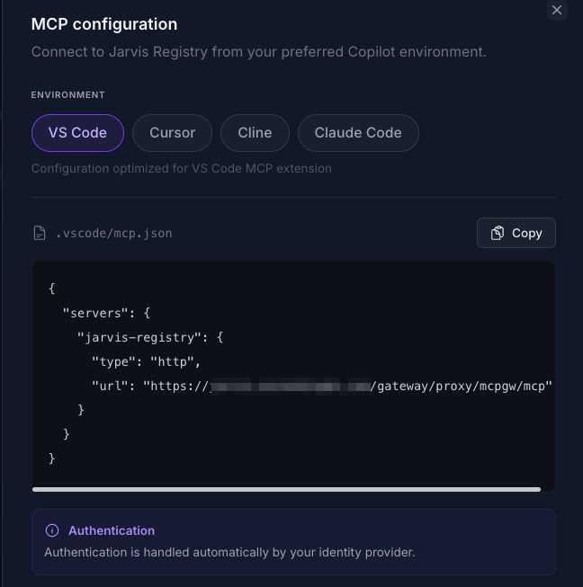
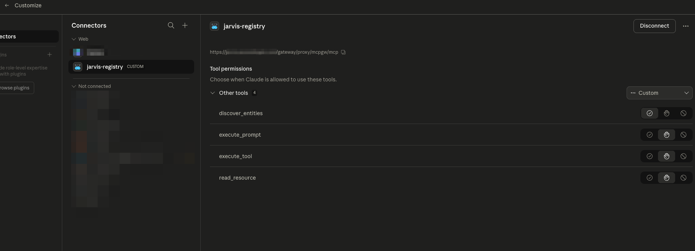
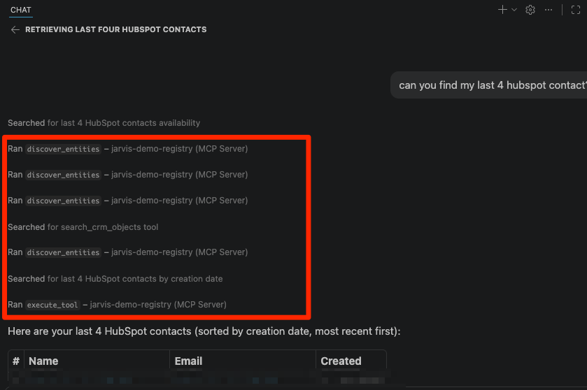

# Registry Endpoint

The Registry Endpoint is the single MCP entry point that AI copilots use to access your enterprise tools and agents.

Instead of configuring every MCP server or A2A agent one by one, you connect your client once to Jarvis Registry. From there, discovery, authorization, token handling, and proxy routing are managed centrally.

---

## One Endpoint for Multiple Copilots

Jarvis Registry supports common MCP clients and coding assistants through the same endpoint model:

- VS Code
- Cursor
- Claude Desktop
- ChatGPT
- Microsoft Copilot
- AWS Kiro
- AWS QuickSuite

All of them connect to the same registry endpoint pattern and then receive only the resources the user is allowed to access.



### Copy the configuration generated for your deployment

Use the Registry's client configuration dialog to generate the endpoint URL and configuration for your client. It includes the deployment's configured base path; do not add `/gateway` unless that is your deployment's base path.

For example, a VS Code `.vscode/mcp.json` configuration for a Registry hosted at `https://registry.example.com` **with `BASE_PATH=/gateway`** is:

```json
{
  "servers": {
    "jarvis-registry": {
      "type": "http",
      "url": "https://registry.example.com/gateway/proxy/mcpgw/mcp"
    }
  }
}
```

A root-mounted deployment instead uses `https://registry.example.com/proxy/mcpgw/mcp`. The example hostname is a placeholder. Other clients use their own configuration format, so copy their generated configuration rather than reusing the VS Code JSON unchanged.



---

## Automatic IdP Authentication

Client access is automatically integrated with your enterprise IdP through the registry auth layer.

What this means in practice:

1. User signs in through the configured IdP flow.
2. Registry validates tokens and resolves user groups/scopes.
3. All downstream MCP/agent access decisions are based on the authenticated user identity.

This gives users SSO-style access and gives admins centralized identity control without per-tool credential setup in each copilot.

Registry sign-in does not replace authorization to a downstream business service. If a registered server requires its own OAuth identity, the user may also need to complete that service's authorization flow. Gateway access and backend record permissions remain separate checks.

For identity setup details, see [IDP Integration](auth-server.md).

---

## Service Discovery with RBAC + ACL Context

The endpoint supports intelligent discovery so clients can find the right capability with natural language context.

Discovery is permission-aware by default:

- **RBAC filter**: endpoint-level permissions based on user role/scope
- **ACL filter**: resource-level permissions for specific MCP servers and agents
- **Context matching**: discovery ranks tools by relevance to the current task

Clients use `discover_servers` to find MCP servers and `discover_agents` to find agents. These public tools return resources the caller is authorized to access. The gateway's `execute_tool` tool invokes a selected MCP tool through the Registry; successful discovery does not bypass the invocation checks.

This prevents accidental exposure while still enabling fast, context-aware tool selection.



---

## OAuth Elicitation Support

Some downstream tools require OAuth re-authentication during use. The Registry Endpoint supports elicitation-style user prompts so clients can recover without manual backend troubleshooting.

When needed, the flow is:

1. A tool call detects missing/expired downstream OAuth authorization.
2. Registry triggers an elicitation/auth prompt back to the client.
3. User completes authentication.
4. Registry resumes the tool path with refreshed authorization.

This keeps the interaction in-session and reduces failed tool calls caused by token expiry.

---

## Agent Path Routing Through Registry Proxy

Users can also call agents directly by their defined path through the registry proxy.

That enables:

- Consistent routing for both MCP servers and A2A agents
- Policy enforcement at the gateway layer
- Easier debugging and targeted testing of a specific agent endpoint

Direct routes still check the applicable server or agent resource permissions. Review the telemetry configured for that route rather than assuming it emits every field needed for an investigation.

The MCP direct-connect proxy does **not** enforce the Registry's server-wide `disabledTools` list. That list hides disabled tools from `discover_servers` and rejects them through `execute_tool`; it is not a per-user tool permission. See [MCP Tool Enablement API](../design/mcp-tool-enablement-api.md) before treating gateway and direct-proxy routes as equivalent.

---

## How the Endpoint Fits the Platform

The Registry Endpoint is the runtime layer that connects all feature areas:

- Resources come from [MCP Server Registry](mcp-gateway-registry.md), [A2A Agent Registry](a2a-gateway-registry.md), and federated sources.
- Security comes from IdP auth, RBAC scopes, and ACL checks.
- Discovery and invocation happen through one consistent interface for every supported copilot.

## Two mins demo videos

<div align="center">
<iframe width="560" height="315" src="https://www.youtube.com/embed/EUqWc_mAaXs?si=WUdFaOM06cQliV1o" title="YouTube video player" frameborder="0" allow="accelerometer; autoplay; clipboard-write; encrypted-media; gyroscope; picture-in-picture; web-share" referrerpolicy="strict-origin-when-cross-origin" allowfullscreen></iframe>
</div>

---

## Next Steps

- [MCP Server Registry](mcp-gateway-registry.md) — Register and share MCP resources
- [A2A Agent Registry](a2a-gateway-registry.md) — Register and share autonomous agents
- [Test MCP access with two users](../walkthroughs/mcp-access-control.md) — Verify allowed and restricted requests
- [AgentCore Federation](agentcore-federation.md) — Import federated MCP servers and agents
- [Security Control Design](../design/security-design.md) — Full auth, RBAC, and ACL model
