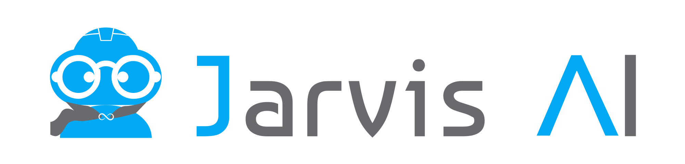
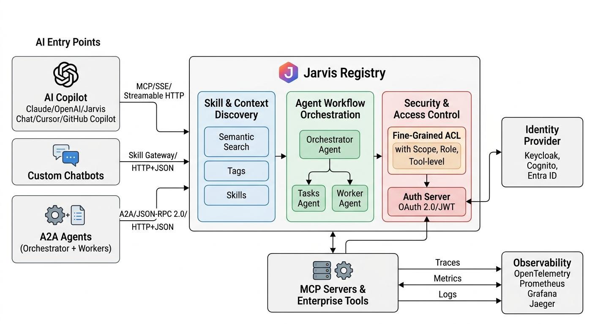

**Jarvis Registry is a self-hostable enterprise AI gateway and registry for connecting AI clients to governed MCP servers(tools), agents, and private skills.** Deploy it in your environment and use its identity, access-control, and observability features to manage how clients reach registered resources.

---

## What is Jarvis Registry?

**Jarvis Registry** is an open-source, enterprise-grade orchestration platform for **[MCP Gateway](https://ascendingdc.com/jarvis-ai/mcp-gateway/), [Agent Gateway](https://ascendingdc.com/jarvis-ai/agent-gateway/), and [Skill Gateway](features/skill-gateway.md)** capabilities built by [ASCENDING Inc](https://ascendingdc.com/jarvis-ai/). It solves one of the hardest problems in enterprise AI: giving AI chatbots, copilots, developer IDEs, and autonomous agents **secure, governed access** to internal tools, data, and approved skills — without fragmented integrations or security blind spots.

Jarvis Registry acts as a **centralized control plane** for tool calling and orchestration between AI clients (copilots, custom chatbots, IDEs, agents) and enterprise MCP servers and skills. Requests are authenticated and checked against configured scopes and resource ACLs before protected resources are returned or invoked. See [Security Control Design](design/security-design.md) for how those controls work together.

Whether you are building a custom chatbot, connecting Claude Code, Codex, GitHub Copilot, Cursor, or VS Code to internal tools, orchestrating fleets of autonomous A2A agents, or federating tools and skills across cloud environments, Jarvis Registry lets your engineers **focus on the user experience** while the platform handles **secure tool discovery, calling, and orchestration** with built-in governance, discoverability, and auditability.

## Private Deployment and Compliance

Jarvis Registry can be deployed in a customer's environment, including private and on-premises deployments. Its authentication, RBAC, resource ACL, and observability capabilities can support a customer's security and compliance controls. A private deployment does not itself grant SOC 2 or another certification; certification applies to the customer's in-scope organization or service and its independently assessed controls.

See the [Deployment Guide](deployment-guide.md), [Security Control Design](design/security-design.md), and [Observability](features/observability.md) for the deployment and control details.

---

## See It in Action

<a class="yt-facade" href="https://www.youtube.com/watch?v=EUqWc_mAaXs" target="_blank" rel="noopener noreferrer" aria-label="Watch Jarvis Registry demo on YouTube (opens in new tab)">
  
  
</a>

---

## What It Does

| Capability | Description |
|---|---|
| [**Gateway & Proxy**](features/mcp-gateway-registry.md) | Single authenticated entry point for supported AI clients and agents — [MCP](https://ascendingdc.com/jarvis-ai/mcp-gateway/) and [agent](https://ascendingdc.com/jarvis-ai/agent-gateway/) routing uses Registry identity, operation scopes, and resource permissions. [Skill delivery](features/ai-skills-cli.md) uses the separate AI Skills CLI workflow. |
| [**Registry**](FEATURES.md#1-registry) | Compliance enforcement layer for [MCP servers](https://ascendingdc.com/jarvis-ai/mcp-gateway/) and [Agent Registry](https://ascendingdc.com/jarvis-ai/agent-registry/) — validates AgentCard schema, MCP tool declarations, and transport compliance (JSON-RPC 2.0, HTTP+JSON); tracks Agent spec version per agent and stores custom discovery paths and auth prerequisites; the single source of truth the gateway derives every invocation decision from |
| [**Chatbot, Copilot & IDE Integration**](features/registry-endpoint.md) | Connect supported MCP-compatible clients to registered enterprise tools through the Registry Endpoint. Skill consumers include Claude Code, Codex, GitHub Copilot, and Cursor; delivery and CLI modes are documented separately in the [AI Skills CLI](features/ai-skills-cli.md). |
| [**Skill Management & Distribution**](features/skill-gateway.md) | Manage private, approved skills with categories, tags, versions, supporting files, and ACLs; import from Git providers including GitHub and GitLab; and distribute accessible skills to consumers including Claude Code, Codex, GitHub Copilot, and Cursor. See [AI Skills CLI](features/ai-skills-cli.md) for its delivery workflow. |
| [**A2A Agent Workflow**](FEATURES.md#5-a2a-agent-workflow-orchestration) | Register and manage autonomous agents; orchestrator agents coordinate worker agents through the same secure gateway |
| [**Identity & Access Management**](features/auth-server.md) | Built-in Entra ID and Keycloak integration for Registry sign-in. Review the identity guide for supported authentication flows and configuration. |
| [**Fine-Grained Access Control**](design/security-design.md) | Role capabilities authorize Registry operations and resource ACLs govern access to servers and agents. [Tool enablement](design/mcp-tool-enablement-api.md) is a per-server disabled-tool list for gateway discovery and execution, not a per-user tool ACL or a transparent-proxy filter. |
| [**Observability**](features/observability.md) | Operational metrics and instrumented agent traces. Verify the emitted fields, exporter configuration, and retention in your deployment against any additional audit requirements. |

---

## Architecture Overview

## Built by ASCENDING Inc

Jarvis Registry is developed and maintained by [ASCENDING Inc](https://ascendingdc.com/jarvis-ai/). For more information about Jarvis AI and our broader AI platform:

- **Website**: [ascendingdc.com/jarvis-ai](https://ascendingdc.com/jarvis-ai/)
- **Jarvis Registry Product Page**: [ascendingdc.com/jarvis-ai/jarvis-registry](https://ascendingdc.com/jarvis-ai/jarvis-registry)
- **Governed AI Layer**: [ascendingdc.com/jarvis-ai/governed-ai](https://ascendingdc.com/jarvis-ai/governed-ai/)
- **Explore Agentic**: [exploreagentic.ai](https://exploreagentic.ai/) — the field guide to enterprise agentic AI, published by ASCENDING
- **YouTube**: [ASCENDING Inc Channel](https://www.youtube.com/channel/UCi5_sn38igXkk-4hsR0JGtw)
- **LinkedIn**: [ASCENDING Inc](https://www.linkedin.com/company/ascendingllc/mycompany/)
- **GitHub**: [ascending-llc/jarvis-registry](https://github.com/ascending-llc/jarvis-registry)
