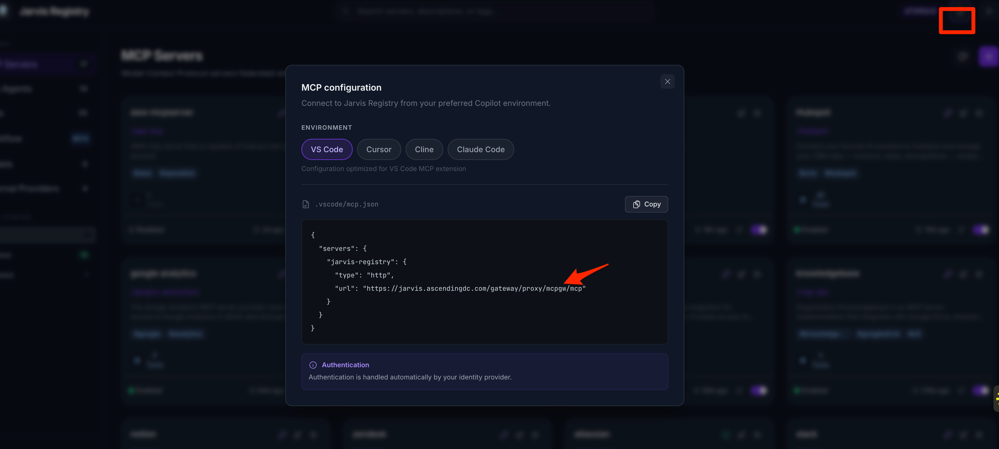
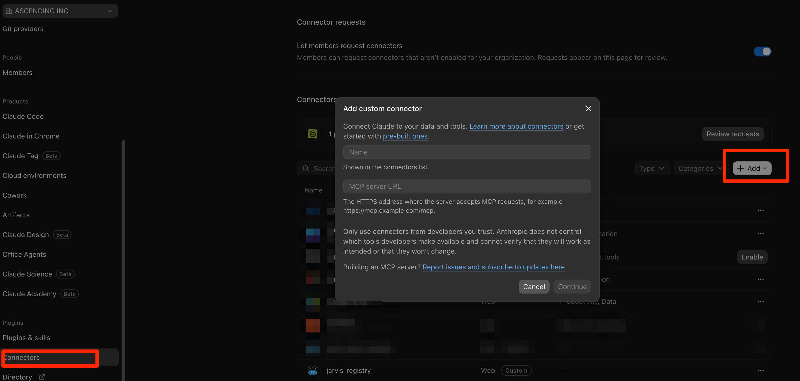
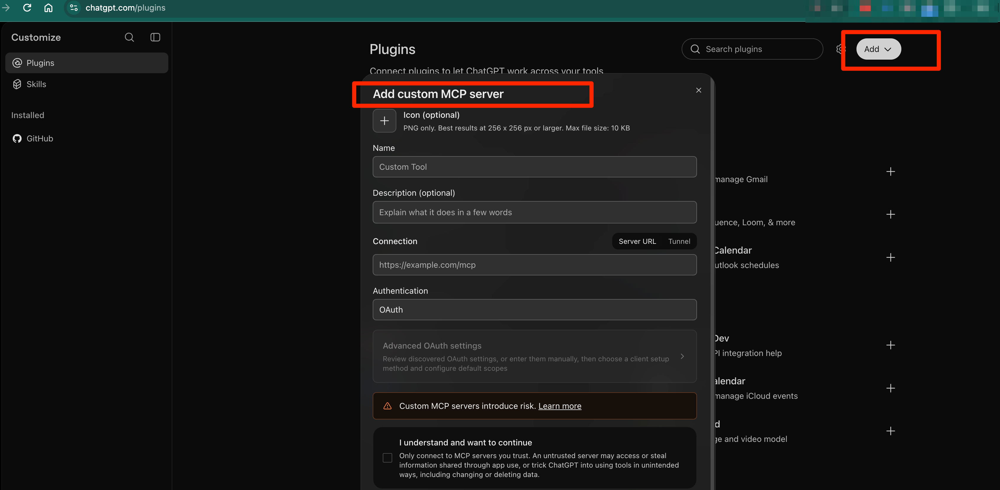

# Configuration Reference

Choose the instructions for your role: developers connect local IDE to the centralized MCP gateway; organization administrators make it available in business chatbots such as Claude and ChatGPT; deployment operators configure the Registry runtime environment.

- [For developers: local client setup](#for-developers-local-client-setup)
- [For organization administrators: business chatbot integration](#for-organization-administrators-business-chatbot-integration)
- [For deployment operators: Registry runtime environment](#registry-runtime-environment-configuration)

## For Developers: Local Client Setup

Connect Claude Code, OpenAI Codex, GitHub Copilot, or Cursor on your workstation to an existing Jarvis Registry gateway. Your administrator provides the gateway and grants access; you configure your client and sign in through your organization's [identity provider](features/auth-server.md#supported-identity-providers).

### Choose Your Gateway URL

Sign in to your organization's Jarvis Registry and open **Integration guide** in the header. Copy the gateway URL from the generated configuration. This preserves your deployment's hostname and base path.



| Environment | Example gateway URL |
|---|---|
| Organization deployment | `https://jarvis.example.com/gateway/proxy/mcpgw/mcp` |
| Local Docker deployment with the `/gateway` base path | `http://localhost/gateway/proxy/mcpgw/mcp` |

Before connecting, make sure:

- Your workstation can reach the gateway, including any required VPN, private DNS, and trusted TLS certificate chain.
- Your administrator has configured the identity provider and granted your account the necessary roles and resource access.
- Your client is current and supports remote MCP over Streamable HTTP and browser-based OAuth.

### Claude Code

Add the gateway for your user account, available across projects:

```bash
claude mcp add --transport http --scope user jarvis-registry https://jarvis.example.com/gateway/proxy/mcpgw/mcp
```

Start Claude Code and run `/mcp`. Select `jarvis-registry` and complete authentication in your browser when prompted, using your organization account. Run `claude mcp list` to inspect configured connections.

For a configuration shared through a project repository, run the command from the project root with `--scope project` instead of `--scope user`. This writes a `.mcp.json` entry:

```json
{
   "mcpServers": {
      "jarvis-registry": {
         "type": "http",
         "url": "https://jarvis.example.com/gateway/proxy/mcpgw/mcp"
      }
   }
}
```

Review and approve project-scoped MCP servers when Claude Code prompts. User-scoped settings are stored in `~/.claude.json`; use the CLI to manage them rather than replacing that file with the project JSON above.

See the [Claude Code MCP reference](https://code.claude.com/docs/en/mcp) for scopes, authentication, and managed configuration.

### OpenAI Codex

Add this table to `~/.codex/config.toml` for your user account. Merge it with existing settings rather than replacing the file:

```toml
[mcp_servers.jarvis-registry]
url = "https://jarvis.example.com/gateway/proxy/mcpgw/mcp"
```

Authenticate and inspect the connection:

```bash
codex mcp login jarvis-registry
codex mcp list
```

Complete the browser sign-in with your organization account. In an interactive Codex session, use `/mcp` to inspect active servers.

For a shared project configuration, put the same table in `.codex/config.toml` instead. Codex loads project settings only for trusted projects. Each developer still authenticates independently. These instructions cover local Codex clients; they do not configure an organization connector in ChatGPT.

See the [OpenAI Codex MCP reference](https://developers.openai.com/codex/mcp/) for supported clients and configuration options.

### GitHub Copilot (VS Code)

Merge the following entry into `.vscode/mcp.json` in your workspace root. VS Code uses the `servers` key rather than `mcpServers`:

```json
{
   "servers": {
      "jarvis-registry": {
         "type": "http",
         "url": "https://jarvis.example.com/gateway/proxy/mcpgw/mcp"
      }
   }
}
```

For a connection available across workspaces, run **MCP: Add Server** from the Command Palette, choose **HTTP**, enter your gateway URL, and select your user profile as the configuration location instead of the workspace.

Run **MCP: List Servers**, select `jarvis-registry`, and start the server. Review any trust prompt and complete the OAuth sign-in in your browser using your organization account. Open Copilot Chat in **Agent** mode and use the tools picker to confirm that the gateway tools are enabled. Your organization's Copilot policies must permit MCP server use.

See the [VS Code MCP server guide](https://code.visualstudio.com/docs/copilot/customization/mcp-servers) for configuration scope, authentication, and tool approvals.

### Cursor

Merge the following entry into `~/.cursor/mcp.json` to make the gateway available across projects, or `.cursor/mcp.json` in a project root to share it with that project:

```json
{
   "mcpServers": {
      "jarvis-registry": {
         "url": "https://jarvis.example.com/gateway/proxy/mcpgw/mcp"
      }
   }
}
```

Open Cursor's MCP settings, enable `jarvis-registry` if needed, and complete the OAuth sign-in when prompted. If the connection does not refresh after editing the file, restart Cursor. Confirm that the gateway tools appear in the client before using them in Agent chat.

See the [Cursor MCP reference](https://cursor.com/docs/mcp) for configuration locations, authentication, and team distribution.

### Verify the Connection

1. Confirm that `jarvis-registry` is connected and authenticated in the client's MCP status view.
2. Ask the assistant to discover an approved tool, for example: "Use Jarvis Registry to find the tools available for our issue tracker." The gateway exposes discovery and execution tools; connecting it does not install every downstream tool as a separate client entry.
3. Invoke a known read-only tool that your account is allowed to use. Check both discovery and execution, not just the connection indicator.

Connecting to the gateway does not grant access to every registered server. Discovery and execution remain subject to the [caller's permissions](features/mcp-gateway-registry.md#resource-sharing-access-control). Some downstream services also require a separate authorization step.

## For Organization Administrators: Business Chatbot Integration

Make Jarvis Registry available inside your organization's Claude or ChatGPT workspace so business users can access approved tools from chat. Administrators register and approve the connection in the AI platform; users select it and sign in when prompted. Users do not edit JSON/TOML files, run CLI commands, or configure individual downstream MCP servers.

| Platform | Organization integration | Business user experience |
|---|---|---|
| Claude Team / Enterprise | An organization owner adds Jarvis Registry as a custom remote MCP connector | Members connect their account and enable the connector in Claude, including Claude Desktop |
| ChatGPT Business / Enterprise / Edu | An authorized administrator adds a custom MCP server through Plugins and approves workspace availability | Authorized users install or connect the approved integration and use it in chat |

### Before You Begin

- Have an organization owner/admin account and a plan that supports custom remote MCP integrations. Availability, role names, and menu labels depend on the platform and plan; consult the vendor guides linked below.
- Complete [Production Deployment](deployment-guide.md), configure your [identity provider](features/auth-server.md#supported-identity-providers), and [register the approved MCP servers](features/mcp-gateway-registry.md). Assign the intended users and groups the required [Registry permissions](features/mcp-gateway-registry.md#resource-sharing-access-control).
- Copy the shared gateway URL from [Integration guide](#choose-your-gateway-url), for example `https://jarvis.example.com/gateway/proxy/mcpgw/mcp`. Use the gateway URL, not a user-specific direct server URL.
- Confirm that the AI platform can reach the gateway and its advertised OAuth discovery, registration, authorization, and token endpoints. Use HTTPS with a trusted certificate. A successful connection from an employee workstation does not establish cloud connectivity.

!!! important "Remote connections do not originate from the desktop app"
   Claude's remote connectors connect from Anthropic's cloud, including when used in Claude Desktop. Your gateway must be reachable from that infrastructure; a private VPN or `localhost` URL is not sufficient. ChatGPT also requires a remotely reachable endpoint, or a supported Secure MCP Tunnel configured by your administrators. Do not expose an unauthenticated gateway to satisfy network requirements.

### Claude: Organization Custom Connector

Sign in as an organization Owner or another role permitted to manage connectors.



1. Open **Organization settings > Connectors**, then select **Add** and the custom connector option.
2. In **Add custom connector**, enter **Jarvis Registry** in **Name**.
3. Paste your shared gateway URL into **MCP server URL**, for example `https://jarvis.example.com/gateway/proxy/mcpgw/mcp`, then select **Continue**.
4. Review the detected OAuth settings and complete the sign-in setup for your deployment. Keep per-user OAuth authentication enabled rather than selecting **No sign in** or supplying a shared user's token.
5. Finish adding the connector and review its availability and tool controls for your organization.

**For business users:** In a chat, select **+ > Connectors > Jarvis Registry**. Sign in with your organization account if prompted. The organization connector can be used in Claude Desktop without editing local configuration files.

See Anthropic's [custom connectors using remote MCP](https://support.claude.com/en/articles/11175166-get-started-with-custom-connectors-using-remote-mcp) for current organization roles, authentication options, and client availability.

### ChatGPT: Custom MCP Server / Plugin

Sign in to the intended ChatGPT workspace as an admin or owner. Enterprise/Edu may also authorize members to create and test connections; workspace publishing remains an admin/owner action.



1. Open **Plugins**, select **Add**, then **Add custom MCP server**.
2. Enter **Jarvis Registry** in **Name**. The icon and description are optional.
3. Under **Connection**, keep **Server URL** selected and paste your shared HTTPS gateway URL. Set **Authentication** to **OAuth**. Use **Advanced OAuth settings** only if your deployment requires specific client settings or scopes. If your administrators have configured a Secure MCP Tunnel instead, select **Tunnel**.
4. Review the risk warning, select **I understand and want to continue**, and choose **Create as a plugin**. Complete OAuth sign-in when prompted.
5. Review the discovered tools and use your workspace's admin controls to approve the tools intended for users.
6. Select **Publish to workspace** (or the equivalent workspace publishing control) and confirm the intended audience. Users can connect only after the integration is published; creating the connection and approving tools alone does not establish organization-wide access.

**For business users:** In a new conversation, type **@** and find and select the approved **Jarvis Registry** plugin or custom MCP server. Sign in with your organization account if prompted, then try a permitted read-only task.

Use **ChatGPT web** for administration. To validate publishing, open a new conversation, type **@**, select **Jarvis Registry**, and try a permitted read-only task. Confirm support in your deployed ChatGPT desktop app before directing users there. Older workspaces may show different Apps or publishing controls; use OpenAI's guide below for those variants.

See OpenAI's [Connecting custom MCP servers in ChatGPT](https://help.openai.com/en/articles/12584461-connecting-custom-mcp-servers-in-chatgpt) for current creation, publishing, network, and plan requirements.

### Business User Access and Validation

Admin approval makes the integration available; it does not grant every user access to every Registry server. Users still authenticate individually, Registry roles and resource ACLs still apply, and some downstream services require additional user consent. Platform tool approval governs the gateway tools exposed to the chatbot; it does not replace Registry authorization for downstream servers.

Before enabling the integration broadly, test with both an allowed and a restricted account using the [two-user access walkthrough](walkthroughs/mcp-access-control.md). Verify discovery and a read-only invocation from the actual chatbot, including any downstream authorization prompt. Review write-capable tools before approving them. When gateway tool definitions change, review and refresh the platform's tool list as required; ChatGPT retains an approved snapshot rather than automatically accepting every change.

!!! warning "Approve the connection, not a shared identity"
   Do not share an administrator's OAuth session, access token, or refresh token with business users. Keep per-user sign-in enabled, and use platform access controls together with Registry permissions. Jarvis Registry governs requests routed through its gateway, not other integrations users connect outside it.

### Gateway Versus Direct Server Connection

The header's **Integration guide** connects to the Registry gateway and is the recommended starting point for access to the shared catalog. A server card's MCP configuration instead connects through the direct proxy to one registered server, using a URL shaped like `/gateway/proxy/server/{userId}/{serverPath}`. Copy that URL from the interface when a single-server connection is required; do not distribute a user-specific direct URL as the organization's shared gateway URL.

### Troubleshooting

| Symptom | What to check |
|---|---|
| Connection refused, DNS failure, or TLS error | Gateway hostname, VPN, trusted certificate chain, and local port mapping. `localhost` refers to the machine running the client, not your organization's server. |
| HTTP 404 or a page of HTML | Copy the MCP URL from **Integration guide**; do not use the Registry UI URL. Check the deployment base path and proxy routes. |
| Repeated HTTP 401 or sign-in never completes | Reauthenticate in the client. Check the identity provider, externally advertised OAuth URLs, discovery routes, and registered redirect URI configuration. An initial 401 can be the normal OAuth challenge. |
| HTTP 403, missing servers, or empty discovery | Confirm the signed-in identity, required roles, resource ACLs, and server availability with your administrator. Reconnecting does not grant permissions. |
| Gateway connects but a downstream tool fails | Check server health, downstream credentials, and any additional user authorization required by that service. |
| Configuration is ignored | Check user versus project scope, project trust/approval, JSON/TOML syntax, and whether an organization policy overrides or restricts the entry. |

## Registry Runtime Environment Configuration

This section is for operators deploying and running Jarvis Registry. These environment files, identity provider settings, authorization rules, and Docker Compose definitions configure the Registry services themselves. They are separate from the MCP client connection files used by developers IDE and the chatbot integration settings managed by organization administrators.

### Active Configuration Files

| File | Purpose | What to do |
|---|---|---|
| [`.env`](https://github.com/ascending-llc/jarvis-registry/blob/main/.env.example) | Main runtime configuration | Copy from `.env.example` into `.env` and set your values |
| [`oauth2_providers.yml`](https://github.com/ascending-llc/jarvis-registry/blob/main/auth-server/src/auth_server/oauth2_providers.yml) | Identity provider (IdP) configuration | Adjust only if you need custom IdP behavior |
| [`scopes.yml`](https://github.com/ascending-llc/jarvis-registry/blob/main/registry-pkgs/src/registry_pkgs/scopes.yml) | RBAC scope and group mapping configuration | Update only when changing authorization rules |
| [`docker-compose.yml`](https://github.com/ascending-llc/jarvis-registry/blob/main/docker-compose.yml) | Base service definitions for Docker deployment | Usually keep as-is |
| [`docker-compose.override.yml.example`](https://github.com/ascending-llc/jarvis-registry/blob/main/docker-compose.override.yml.example) | User override template for Docker services | Copy to `docker-compose.override.yml` and customize locally |

### Environment Setup

1. Create your main environment file:

   ```bash
   cp .env.example .env
   ```

2. (Optional) Create a local Docker override:

   ```bash
   cp docker-compose.override.yml.example docker-compose.override.yml
   ```

3. Edit only what you need in `.env` and `docker-compose.override.yml`.

### Notes

- OAuth credential and AgentCore-specific setup content was removed from this page because those flows are now handled in the interface.
- `oauth2_providers.yml` is the IdP configuration source for authentication providers.
- `oauth_providers.yaml` is intentionally not included here.
